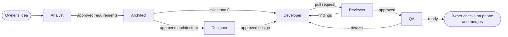

# agents

A small team of AI agents that work together as a software company for
building Android apps and games. Each agent has one role, works from the
approved output of the agent before it, and stops for the owner's sign-off
before the next one starts.

This repository is the **master copy** of the role definitions. Edit the
roles here, then copy them to wherever they are used, so the copies never
drift apart. The roles are generic: nothing in them belongs to one app.

## The team

| Role | File | Produces |
| --- | --- | --- |
| Analyst | [`agents/analyst.md`](agents/analyst.md) | Requirements document with numbered, testable FRs and NFRs |
| Architect | [`agents/architect.md`](agents/architect.md) | Architecture document, build order and build-and-release setup |
| Designer | [`agents/designer.md`](agents/designer.md) | Design document: colours, typography, icon, mockups |
| Developer | [`agents/developer.md`](agents/developer.md) | Code, one milestone per pull request, green in CI |
| Reviewer | [`agents/reviewer.md`](agents/reviewer.md) | Review report with findings and a verdict |
| QA Engineer | [`agents/qa.md`](agents/qa.md) | Test report, added tests, manual checklist for a phone |
| Tech Lead | [`chat/tech-lead.md`](chat/tech-lead.md) (chat), [`agents/tech-lead.md`](agents/tech-lead.md) (Claude Code) | Current status, next steps as checklists, prompts for the other roles |

The Tech Lead is not a step in the pipeline. It works alongside it: it
checks the real state of the repository, keeps `docs/status.md` current,
and checks what the other roles report against what they were asked to do.

## Workflow



- The owner approves every document and every merge. An agent never hands
  off unapproved work.
- Problems flow backwards: the developer raises design questions with the
  architect, and anyone raises requirement problems with the analyst.
- Documents live in the app's repository under `docs/` (`requirements.md`,
  `architecture.md`, `design.md`), each with a status line at the top.
  `docs/status.md` holds the current status, kept by the Tech Lead.
- Mechanical checks are done by tools in CI, not by agents: ktlint, detekt,
  Android Lint and Dependabot.

## Where each role runs

**Document roles (Analyst, Architect, Designer)** ask the owner questions in
rounds, so they work best in a Claude chat project. Paste this line at the
top of the project instructions, followed by the body of each role file
(everything below its `---` header) under a `## Role: <Name>` heading:

```
This project has several roles. Each chat starts with a line such as
"Role: Analyst" or "Role: Architect". Act only as that role and follow only
its section below. If no role is given, ask which one before doing anything.
```

Then start each chat with, for example:

```
Role: Architect
The approved requirements for <app> are in the project context. Please begin.
```

**Tech Lead overview chat.** The Tech Lead can also run in the chat project,
linked to your computer, to keep the overview across chat and Claude Code
and keep the project's context documents in step with `docs/`. Its chat
version is in [`chat/tech-lead.md`](chat/tech-lead.md); paste it into the
project instructions like the document roles.

**Code roles (Developer, Reviewer, QA) and the Tech Lead** need the
repository, so they run in Claude Code. The files are already in Claude Code's agent format. Copy them
to your user-level agents folder so they are available in every project:

```powershell
# Windows (PowerShell)
New-Item -ItemType Directory -Force "$HOME\.claude\agents" | Out-Null
Copy-Item .\agents\*.md "$HOME\.claude\agents\"
```

```bash
# macOS / Linux
mkdir -p ~/.claude/agents && cp agents/*.md ~/.claude/agents/
```

All seven files can be copied; the document roles also work in Claude Code if
you prefer to keep everything there. When an agent runs as a sub-agent and
cannot talk to you directly, it ends its output with its questions and
stops, so answer them and run it again.

## Models

Each role file sets the model it runs on in Claude Code. The choice
balances quality against usage limits:

| Model | Roles | Why |
| --- | --- | --- |
| `opus` | Analyst, Architect, Designer, Reviewer | Few, short runs where mistakes are expensive: decisions made early, and an independent review |
| `sonnet` | Developer, QA, Tech Lead | Long or frequent runs on well-defined work, where usage adds up |

- To use a stronger model for one hard task (a difficult milestone, a bug
  that keeps coming back), switch with `/model` in Claude Code instead of
  editing the file.
- The reviewer runs on a different model from the developer on purpose, so
  it does not share the developer's blind spots.
- The `model` line only applies in Claude Code. In a claude.ai chat project,
  pick the model in the chat's model menu instead.

## Skills

Skills are step-by-step procedures that any role can follow. They live in
`skills/<name>/SKILL.md`.

| Skill | Use it for |
| --- | --- |
| [`android-app-bootstrap`](skills/android-app-bootstrap/SKILL.md) | Milestone 0 setup outside the code: GitHub repo, Firebase, Firestore, release keystore, CI secrets and emulators, run by CLI with the owner approving each command |
| [`android-lessons-learned`](skills/android-lessons-learned/SKILL.md) | Checks drawn from problems found in earlier apps, used by the Developer, Reviewer and QA on every milestone, and by the Analyst and Designer when planning |

To use a skill in Claude Code on every project, copy its folder to your
user-level skills folder:

```powershell
# Windows (PowerShell)
New-Item -ItemType Directory -Force "$HOME\.claude\skills" | Out-Null
Copy-Item -Recurse -Force .\skills\* "$HOME\.claude\skills\"
```

```bash
# macOS / Linux
mkdir -p ~/.claude/skills && cp -r skills/* ~/.claude/skills/
```

## App-specific rules

Anything that belongs to one app (its name, services, data rules,
milestones) goes in that app's repository, not here:

- `docs/` holds the approved requirements, architecture and design.
- `CLAUDE.md` in the app's repository root holds short project notes that
  Claude Code reads automatically, for example which documents to read and
  any app-specific rules.

## What the owner does by hand

Agents never handle accounts, money or secret values. Setup steps that a
command-line tool can do (gh, firebase, keytool) may be run by an agent, but
only after the owner has signed in to that tool personally and approved the
command. The `android-app-bootstrap` skill follows these rules. The owner:

- Creates accounts, accepts terms and handles anything with billing
- Signs in to gh, firebase and other tools personally
- Approves every setup command an agent runs
- Types the keystore passwords and stores the keystore and passwords safely
- Turns on sign-in providers in the Firebase console
- Sets up the Google Play developer account and submits releases
- Approves each document, checks each milestone on a real phone, and merges

## Changing a role

1. Edit the role file in this repository and commit the change.
2. Copy it again to `~/.claude/agents/` and, for document roles, into the
   chat project instructions.
